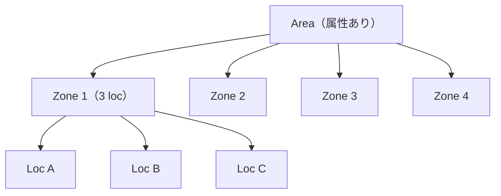
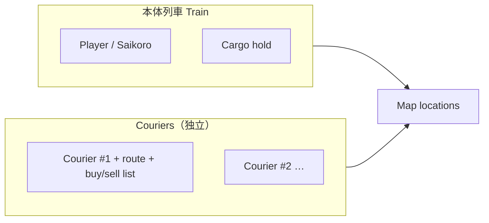

# Systems — Map / Train / Courier / Safety

**言語:** 中／英／日混寫。日本語は概念ラベル用。  
**Scope:** 系統與可視化。經濟數值見 `economy.md`（未寫）。敘事見 `story.md`（未寫）。

---

## 1. World hierarchy（世界階層）

```
World
 └── Area（区域 / エリア）× N
      ├── Area property（该区域固有属性）
      └── Zone（分区 / ゾーン）× 4 per Area
           └── Location（站点 / ロケーション）× 3 per Zone
```

| 層級 | 規則（v1） | 備註 |
|------|------------|------|
| **Location** | 可停靠、買賣、接運送委託 | 有獨立 market price table |
| **Zone** | **固定 3 locations** | 第一個 Zone 清完後解鎖 **courier** |
| **Area** | **固定 4 zones** | 有 **own property**（氣候／資源傾向／路線限制等，細節 TBD） |
| Unlock | **特產** 推進下一 Location／Zone／Area | 見 economy |

> 總站數不在文件鎖死；成長節奏由「分區 + 特產解鎖」驅動。

### 1.1 Area property（区域属性）— v1 已定三類

每個 Area 應同時能表達（強度可不同）：

| 類別 | 作用 | 例（placeholder） |
|------|------|-------------------|
| **氣候／地形風味** | 拉動價格基調與特產傾向 | 砂漠＝水貴、礦多；濕地＝食材特產 |
| **路線門檻** | 要特定車廂／升級才進得去 | 高架橋要「登山車廂」；廢都要過濾艙 |
| **經濟修正** | 運費、價格波動、稅 | 關稅區＋稅；動盪帶波動大；近線運費低 |

→ 對應擴建卡點 **C（有時）**。具體 Area 表之後另檔；此處鎖定三類都要。

---

## 2. Visualization overview（可視化總覽）

遊戲（與本文件示意）需能辨識：

| 對象 | 玩家要看出什麼 |
|------|----------------|
| **Map** | Area → Zone → Location 關係、已解鎖／鎖定、目前所在 |
| **Train（本體）** | 位置、貨廂容量、移動中／停靠中 |
| **Player（Saikoro）** | 與本體火車綁定的操作焦點（你本人在開這列） |
| **Courier** | 獨立單位位置、其路線與貨物、與本體不同色／圖示 |

### 2.1 Map schematic（ASCII）

```
Area α  [property: …]
┌─ Zone 1 ──────────────┐  ┌─ Zone 2 ──┐
│  ●A ── ●B ── ●C       │  │  ○ ○ ○    │
│  ^you                 │  │  locked   │
└───────────────────────┘  └───────────┘
┌─ Zone 3 ──┐  ┌─ Zone 4 ──┐
│  ○ ○ ○    │  │  ○ ○ ○    │
└───────────┘  └───────────┘

● = unlocked location   ○ = locked
── = rail link (same zone; cross-zone TBD)
```

### 2.2 Mermaid — hierarchy



### 2.3 Train + Player + Courier（同畫面概念）

```
Map rail:   [Loc A]====[Loc B]====[Loc C]
                 🚂 YOU          📦 courier→
                 Saikoro         (own cargo)

YOU = player train（本体）
courier = 独立单位（本体货厢を占有しない）
```



**UI 建議（非實作）：** 地圖上本體與信使用不同標記；點信使可編輯路線與買賣清單；點本體進買賣／擴建。

**地圖表現（已定）：** **2D 節點圖** — Location 為節點，鐵路為邊；Area／Zone 可用框或顏色分組。

---


## 2.5 Rails & travel graph（鐵軌與換區）

| 規則 | 決策 |
|------|------|
| Zone 內連線 | **每 Zone 不同**（資料驅動）；部分邊 **預設**，部分可 **建造** |
| 建軌消耗 | **Gold＋共通材料＋特產** |
| 跨 Zone／Area | **主線任務**打通（非單純自動連線） |

## 2.6 Light events（非戰鬥）

- **無戰棋／無戰鬥系統。**
- 事件類型例：搶劫、護車等。
- **檢定：** 類 **CoC（Call of Cthulhu）骰** 決定成功／失敗。
- **修正：** **道具** 提供加成；**hazard** 提供減成。
- 不變成另一套戰棋玩法；仍服務跑商節奏。
- **v1 技能：** **Bargain（交涉）**、**Spot（觀察）**。
- **成長：** 來自 **quests**（非用就升／非買點）。
- 其餘屬性表 TBD。

## 3. Player train（本体列車）

### 3.1 Role

- 前期 **親自跑線** 買賣是主循環。
- 擴建／路線仍可能卡 **C**（Area 路線門檻）與 **D**（courier 解鎖，見 §4）。

### 3.1b Upgrade tracks（三線獨立升級）

| Track | 效果 |
|-------|------|
| **Speed** | 移動更快 |
| **Capacity** | 貨艙更大／可載更多 |
| **Preserve rate** | 降低運輸中損耗 |

- 三線 **分開升級**，互不鎖死。
- 費用暫定：**Gold＋共通材料**（可再調）。
- **貨物耗損：** v1 tags = **liquid**、**volatile**（各有 deplete rate）。
- **結算時機：** **離站後**依 **行駛時間**結算損耗（非到站前逐幀預扣給玩家看也行，但規則上綁 travel time）。
- **Preserve rate** 降低上述耗損。

### 3.1c Condition → sell price（保存狀態與賣價）

貨物離開站後依時間耗損，剩餘 **condition %**（受 preserve rate 影響）決定賣價相對 market price（MP）：

| Condition | 賣價（相對 MP） | 備註 |
|-----------|-----------------|------|
| 100–90% | **100%** MP | |
| 89–50% | **約 60%** MP | 粗分檔 |
| 49–1% | **約 59% → 10%** MP | 隨 condition 下滑 |
| 0% | **0%**（waste） | 運委託若貨歸零 → **quest failed** |

粗規則備註（設計意圖）：`preserve`-related readout 大致 **condition + 10% ≈ 可拿到的 MP%**，**上限 100%**，下限落到 **~11%／0%**（與上表對齊時再精修公式）。

Train **Preserve rate** 升級 = 讓 condition 掉得慢，從而保住賣價與 quest。

- 特殊車廂／路線門檻可另掛在擴建或獨立解鎖（與三線並行，TBD）。

### 3.2 Soft fail（安全網）

幾乎不會 game over。沒錢時：行動變慢、擴建暫停、仍可接低利 **運送委託** 回血。不強制破產重開（威望是後期敘事 mechan ic，見 story）。

---

## 4. Courier（信使 / 使い）

| 項目 | 決策 |
|------|------|
| 解鎖時機 | ① Zone1 通關支線 → Zone1-only；② **約 Zone3 支線** → **universal（all Areas）** |
| 與本體關係 | **獨立單位**，不佔本體貨廂 |
| 行為 | 玩家設定 **買賣清單（buy/sell list）** + **路線（route）**，信使執行 |
| 定位 | Zone1 本地加速 → Zone3 後 universal 加速；不取代前期親手貿易 |

### 4.0 Unlock narrative（解鎖敘事鉤）

1. 玩家完成 **Zone 1**（三站可達／主進度達成，精確條件可與特產解鎖對齊）。
2. Zone1 出現 **side quest**：當地 NPC 想向玩家學習跑商。
3. 完成後該 NPC 成為第一名 **courier**，初期路線／活動範圍預設在 **Zone1**。
4. **第一名信使**活動範圍永久限定 **Zone1**。
5. **約 Zone3** 另有支線解鎖 **universal courier（通用信使）**：可跑 **all Areas**（仍受路線門檻／Area property 限制）；玩家設買賣清單與路線。
6. 在解鎖通用信使之前，Zone2+ **靠本體親自跑**。

### 4.1 Ops detail（操作細節）

| 項目 | 決策 |
|------|------|
| 路線 UI | **點站加入路線清單**，可設為 **循環** |
| 買賣清單 | **每站各自**設定買哪些／賣哪些 |
| 資產 | 信使／跟隨者 **獨立錢包＋獨立貨艙**（不佔本體） |
| 與本體交接 | **非遠端互通**；透過 Area 的 **倉庫／安全屋（warehouse / safe house）** |
| 倉庫 | **每個 Area 一個特殊 Location 節點**；本體與 follower 皆可存取 **gold／goods／items** |

### 4.2 Loop（抽象）


1. 玩家解鎖至少 1 courier slot  
2. 指定 route：Loc 序列（可循環）  
3. 指定 list：在哪些站買／賣哪些貨（或「跟行情閾值」— 細節交 economy）  
4. 信使沿路線移動、在站執行、回報金幣／庫存  
5. 可升級：更多 slots、更快、更大獨立容量（TBD）

### 4.3 與 Quest 的關係

運送委託（A→B、低利純賺）可由 **本體** 接；信使是否可跑 quest **未定**（economy／後續問題）。

---

## 5. Transport quest（運送委託）— systems 側

- 類型：指定貨物從 Location X → Y  
- 報酬：幾乎保底金幣，**利潤很低**（當安全網／教學／填空車）  
- 不取代差價貿易的高上限  

數值表 → `economy.md`。

---

## 6. Open questions（systems）

0. ~~倉庫呈現~~ → **每 Area 一特殊 Location 節點**；解鎖條件？


1. Cross-zone / cross-area 鐵路是自動連通，還是要鋪軌／通行證（Area property）？  
2. ~~Courier 解鎖精確條件~~ → **已定：Zone1 通關後支線 NPC 拜師；先在 Zone1 貿易**（之後能否出區 TBD）  
3. Courier 人數：Zone1 一名 + 後期至少一名 universal；再多人？升級曲線？ TBD  
4. 本體與 courier 可否同站搶同一供需（影響價格）？  
5. Area property **三類已定**（氣候／門檻／經濟修正）；待補：第一批具體 Area 名稱與數值？  
6. ~~地圖可視化是 2D 節點圖、還是一條主幹線 + 支線？~~ → **已定：2D 節點圖（站點＋連線）**

---

7. ~~其他 Zone 的信使~~ → Zone1-only 先；**約 Zone3 → universal courier（all Areas）**

---

## 7. Out of scope here

- 商品列表、價格公式、特產表 → `economy.md`  
- 開場換身、威望獎勵 → `story.md`  
- 檔案結構、`engine.js` / `viewUpdating.js` 對齊 → `tech.md`
